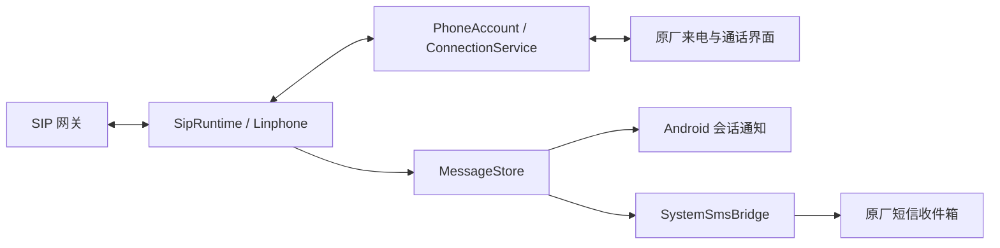

# 开发与联调

## 结构

```text
app/src/main/        SIP 服务、Telecom 集成、短信和原生 UI
app/src/debug/       受 DUMP 权限保护的调试入口、独立数据库检查
app/src/test/        账户配置与 SIP 号码处理单元测试
magisk/             模块安装、启动授权与卸载脚本
scripts/            构建、模块打包、账户导入和本机 SIP fixture
docs/               安装、验证、发布与网关接入说明
```



主要入口：

- `SipRuntime.kt`：注册、重连、通话、媒体设备与 MESSAGE。
- `TelecomBridge.kt`：固定系统通话账户、呼入呼出及系统回调。
- `MessageStore.kt`：私有消息数据库、迁移、搜索、未读及分页。
- `SystemSmsBridge.kt`：可选单向收件箱副本，不阻塞 SIP 回调。
- `MessageNotifications.kt`：原生消息通知、回复和已读操作。
- `MainActivity.kt`：拨号、会话与账户设置。
- `OppoDialpadHook.java`：可选、按系统和原厂电话版本限定的 LSPosed 扩展。

## 构建参数

`scripts/build.ps1` 默认使用仓库内的 Gradle Wrapper，依赖从官方仓库下载。支持：

| 参数 | 用途 |
| --- | --- |
| `-Offline` | 仅使用已有缓存 |
| `-NoProxy` | 仅为本次构建绕过失效代理，不修改全局设置 |
| `-LinphoneAar <path>` | 使用本地 Linphone 5.4.124 完整 AAR |
| `-XposedApi <path>` | 使用本地 Xposed API 82 JAR，仅参与编译 |
| `-GradleExecutable <path>` | 显式使用已安装的 Gradle 可执行文件 |

若存在 `.tools/linphone-complete.aar` 或 `.tools/xposed-api-82.jar`，脚本会采用对应本地依赖。这些文件不提交。

单独打包已签名 APK：

```powershell
.\scripts\package-module.ps1 -Apk path/to/signed.apk
```

脚本每次使用独立临时目录，打包 APK 和对应原生库，避免混入上次构建的文件；输出位于 `dist/`。

## 本机 SIP fixture

Python 3，无第三方依赖：

```sh
python scripts/sip-lab.py --host 127.0.0.1 --bind 127.0.0.1
```

测试账户为 `lab / lab-only-password`，仅用于隔离测试。TCP 监听 5072，HTTP 控制端仅监听 `127.0.0.1:8766`；支持 `/state`、`/message`、`/invite`、`/bye`、`/drop`。fixture 使用固定测试 nonce，不适合作为生产 SIP 服务。RTP 测试需要独立确认媒体地址连通性。

## 调试构建

调试接收器仅存在于 debug 变体，并要求调用方具有 `android.permission.DUMP`。release APK 不包含它。

```sh
adb shell am broadcast -n dev.mysip/.DebugReceiver --es op state
adb shell am broadcast -n dev.mysip/.DebugReceiver --es op storage-checks
```

账户导入脚本需要已安装的 debug APK 和可用 Root ADB。交互模式必须明确指定连接参数，密码隐藏输入：

```sh
python scripts/provision-device.py --host pbx.example.invalid --port 5060 --user extension --transport TCP
```

多个设备时加 `--serial <ADB序列号>`；自动化可用 `--stdin` 读取完整 JSON。密码不放入命令参数或仓库，临时导入文件在应用私有目录中创建并清理。

提交问题或修改前请移除日志中的密码、鉴权头、真实号码和短信正文。更改数据库或消息流程时验证迁移、去重与副本范围；更改 Telecom 或前台服务时验证真机后台行为。
